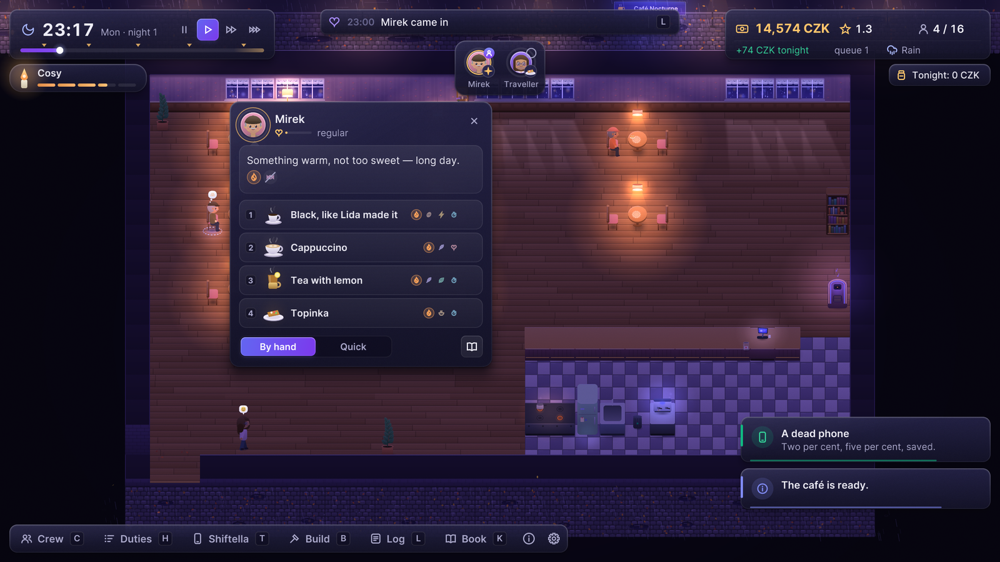
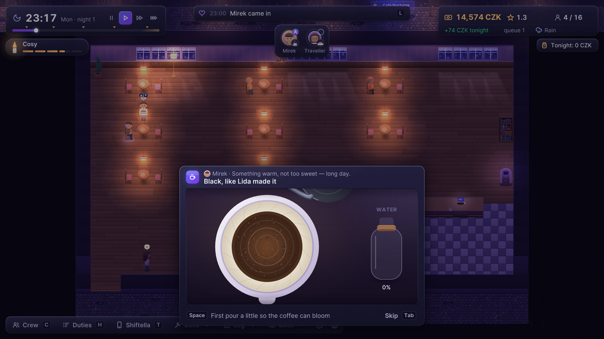
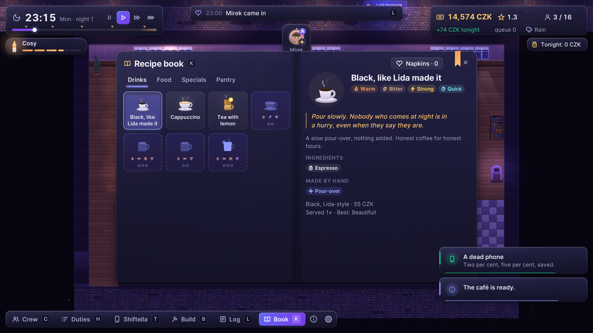
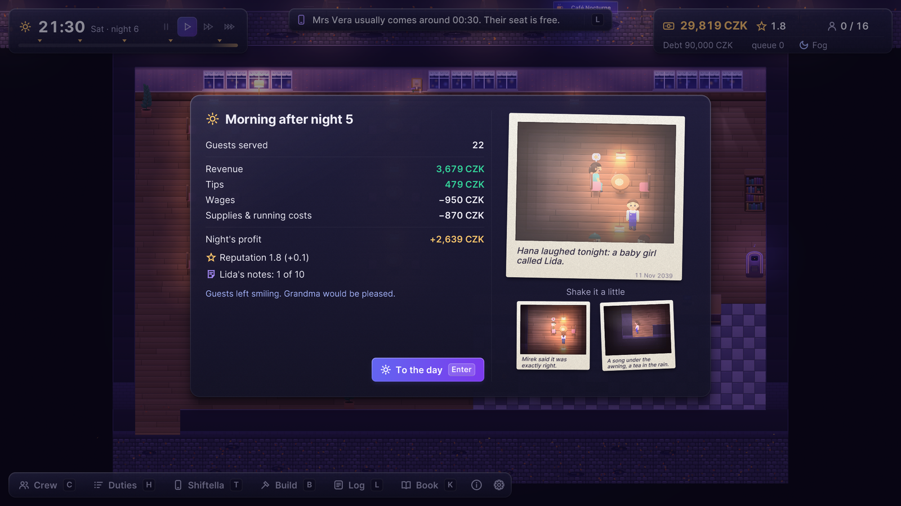
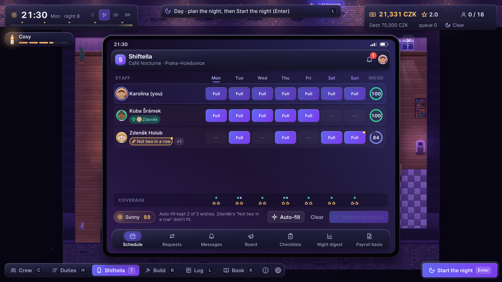
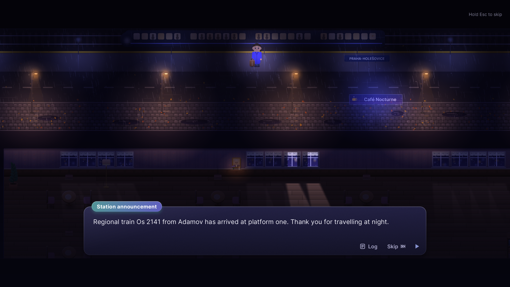
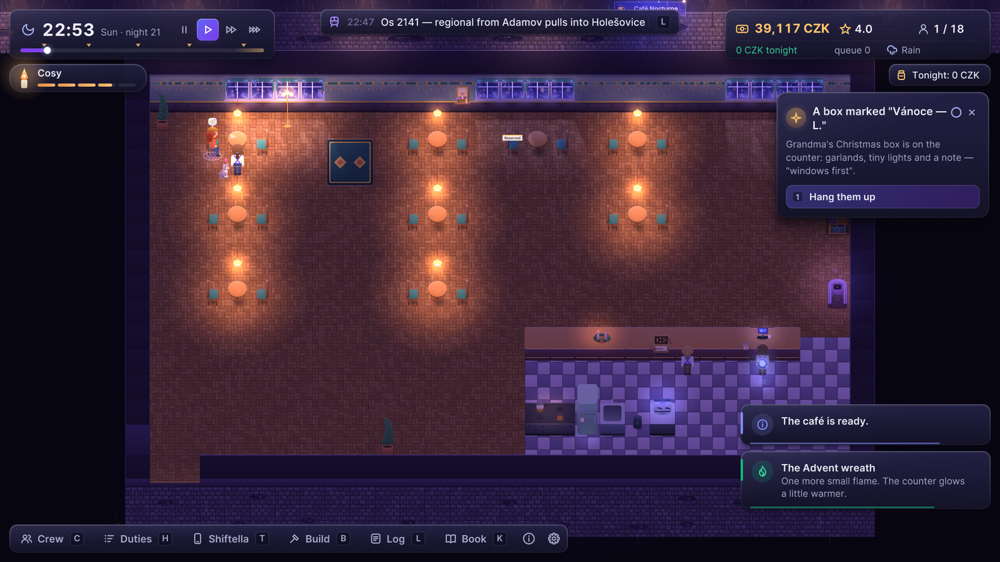

<p align="center">
  
</p>

<h1 align="center">Shiftella</h1>

<p align="center">
  <b>A cozy night-café game for the evening after your own shift.</b><br>
  Prague, 2039 · Café Nocturne by Praha-Holešovice station · open 22:00–06:00
</p>

<p align="center">
  <a href="https://github.com/NnnotAnwar/shiftella-game/releases/latest"><b>Download for macOS</b></a> ·
  <a href="docs/PLAYING.md">How to play</a> ·
  CZ · EN · UA · RU
</p>


Karolina inherits her grandma Lida's little night café next to a Prague railway station. It rains,
the lamps are warm, autonomous night trains slide past the windows — and every night at exactly
**3:33** the clock stops and a quiet man in an old coat comes in for tea with lemon.

You don't watch the café run itself. **You are behind the counter**: greet the guests, read what
they *really* want, brew it by hand, serve it, clear the tables, collect the tips — and slowly learn
the stories of the regulars who keep coming back. Thirty nights to pay off grandma's debts and find
out why she never switched off the light in the window.

## What you do every night

- **Take orders by mood, not by menu.** "Something warm, not too sweet — long day." Pick the recipe
  that fits, or offer *the usual* to the ones you already know.
- **Brew by hand.** Short, relaxing mini-games that can't be failed: froth the milk, pour latte art
  (a heart, a tulip, a little train…), a slow pour-over, steep the tea to the right colour, plate
  grandma's medovník. Or brew quickly when the rush comes after a train.
- **Run a small crew — your way.** Hire helpers and hand them only the duties you choose: the dishes,
  the plain coffees, the kitchen. Regulars, wishes and stories always need you.
- **The Shiftella app.** The café's shifts, swaps, time off, handover notes, checklists, a night digest
  and the payroll basis live in an in-game app — a little love letter to the real
  [Shiftella](https://shiftella.app) scheduling app. Staff have wishes ("lectures on Tuesdays",
  "night owl"); a fair rozpis keeps everyone happier.
- **Little night moments.** Light candles in a blackout, put a bucket under the leaking roof, wipe the
  fogged window to see the train, feed the station cat (it may stay), choose a record on grandma's
  jukebox — the music really changes.
- **The café changes with you.** Late autumn rain turns into the first snow; in December you hang
  grandma's garlands yourself. Unlock decor themes, discover recipes in the book, and keep a polaroid
  journal of each night's best moment.

| | |
|---|---|
|  |  |
| *Mirek's order: what he wants, the best matches, "the usual?"* | *Brewing by hand — a slow pour-over* |
|  |  |
| *Grandma's recipe book, with her notes in the margins* | *The morning after: the night's polaroid develops* |
|  |  |
| *The in-game Shiftella app — the weekly rozpis as a light puzzle* | *Arriving at Holešovice on the last train* |



## Features

- **Story mode** — 30 nights (7 Nov – 6 Dec 2039), seven regulars with their own arcs, grandma's ten
  notes, cutscenes, and **two endings**: «Light in the Window» and «Last Train».
- **Sandbox** — endless nights in Prague, Brno, Vienna, Kraków… from a shareable seed.
- **Cozy by default** — nothing to fail, guests wait and forgive. **Classic** makes the payments matter.
- **Four languages** — Čeština, English, Українська, Русский.
- Mouse *and* keyboard-only play, a gentle tutorial, a "How to play" page (F1), save slots and autosave.
- An original "violet dollhouse" art style drawn entirely in code — no sprite sheets.

## Download & play

**macOS (Apple Silicon & Intel):** download `Shiftella-macos.zip` from the
[latest release](https://github.com/NnnotAnwar/shiftella-game/releases/latest), unzip, and open
`Shiftella.app`. The app is not notarized yet: on first launch, right-click → **Open** → **Open**.

How to play, all controls and tips: **[docs/PLAYING.md](docs/PLAYING.md)**.

## Build from source

Rust (edition 2024) + [macroquad](https://macroquad.rs) 0.4.

```bash
cargo run --release          # the game
cargo test                   # content, i18n, simulation, saves, the game flow (headless)
cargo clippy --all-targets
scripts/package-macos.sh     # dist/Shiftella.app + dist/Shiftella-macos.zip
```

**Most audio is not in this repository.** The music and most sound effects were generated with
[ElevenLabs](https://elevenlabs.io), whose licence allows them in the game but not redistributed on
their own, so they ship only inside the release build. A source build plays only the CC0 sounds
in `assets/audio/cc0/` (appliances, the walk home, the back step; sources and changes in
`assets/audio/CREDITS.md`, cut with `design/audio/cut_cc0.sh`). To generate your own audio, put
`ELEVENLABS_API_KEY=…` in `.env` and run `python3 -I design/audio/generate.py` (prompts in
`design/audio/prompts.json`).

## Repository layout

| Path | What |
|---|---|
| `src/app/` | the app state machine: boot → language → menu → game → credits |
| `src/screens/` | the running game (live café, HUD, panels, the Shiftella app, build, day & morning), menu, credits |
| `src/sim/` | the simulation behind `sim::World` — Karolina, guests, crew, moments, rozpis… ([docs/SIM.md](docs/SIM.md)) |
| `src/content/`, `src/i18n/` | data model, loader and translations ([docs/CONTENT.md](docs/CONTENT.md)) |
| `src/render/`, `src/ui/`, `src/minigame/`, `src/cutscene/` | world renderer, glass UI kit, brewing mini-games, cutscene player |
| `assets/` | game data (`data/*.ron`), translations (`i18n/src/*.tr`), Inter font, icon |
| `design/`, `docs/` | design notes, the game brief, QA report ([docs/README.md](docs/README.md)) |

Developer automation (jump into any scene, autoplay, invisible screenshot runs) is described in
[docs/PLAYING.md](docs/PLAYING.md) and [docs/QA-0.1.0.md](docs/QA-0.1.0.md).

## Credits

Made with love by **Anwar** & **Claude**. Music and sound effects: ElevenLabs, plus CC0
recordings from Freesound and Kenney (listed in `assets/audio/CREDITS.md`). Font:
[Inter](https://rsms.me/inter/) (SIL Open Font License 1.1, see `assets/fonts/OFL.txt`).
Train stations on the line are named after Shiftella release codenames — Adamov, Beroun, Cheb,
Děčín, Ejpovice, Frýdlant.

© 2026 Anwar. All rights reserved for the game's code, art and story unless stated otherwise.
